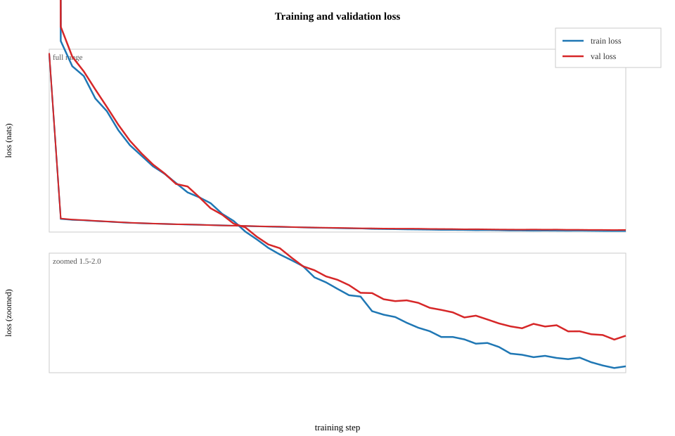

# chargpt

A tiny character-level GPT in Mojo (CPU): KV-cached decoding with temperature/top-k sampling.

[Quick start](#quick-start) · [How the text improves](#how-the-text-improves) · [Results](#results) · [The key-value cache](#the-key-value-cache) · [How it works](#how-it-works) · [Tests](#tests) · [Arguments](#command-line-arguments)

chargpt trains a 6-layer transformer of about 4.3 million parameters on Tiny Shakespeare, then writes text one character at a time. The tensors and autograd come from [Tenmo](https://github.com/ratulb/tenmo) and the tokenizer from [mbpe](https://github.com/ratulb/mbpe). Both are Mojo libraries by the same author, so the whole path from raw text to an AdamW update is Mojo: no PyTorch, no NumPy, no Python in the loop.

It is a teaching project that tries to be verifiable. The cached decoding path is tested against the plain one, token for token. It follows the structure of nanoGPT and is a small companion to [*Tokens to Transformers in Mojo*](https://ratulb.github.io/tokens-to-transformers/), a book in progress that builds a GPT-2 from scratch, tokenizer to training loop, on the same two libraries.

A sample from the finished default run (the last generated output; it starts mid-word because the prompt is five characters from a random place in the validation text):

```text
pparently faction.

KING EDWARD IV:
Fair brother's mother, who dost thou so? and thou,
That thought to make a perison to one,
Con the same thing eyes of the common people,
Or the father new refuge the glory by the hire.
What's lambs? love I am dishonour'd?
What news shall were the crown? if I be consul,
I come, or not the stock of the meeting in
the mourning through the semularies of access,
Not stir the bury of Mantua.

CORIOLANUS:
No remember one a cardon of her that hath show'd
To beggars, and the
```

## At a glance

| | |
| --- | --- |
| Model | 6-layer pre-norm transformer, 6 heads, 240 wide, 96-character context, about 4.3M parameters |
| Data | Tiny Shakespeare, 1,115,394 characters, last 10% held out for validation |
| Tokenizer | mbpe `BPETokenizer` with a one-character pre-tokenizer: 256 byte ids |
| Training | 10,000 steps of 32 windows × 96 characters (about 27.5 passes over the text), AdamW at 1e-3, dropout 0.1 |
| Result | validation loss 1.49 nats at its best, at step 5,400; 1.55 at the end, where the model has begun to overfit. The bigram baseline reaches 2.49


## Quick start

You need:

- [Mojo](https://docs.modular.com/mojo/manual/) 1.1.0, set up with [pixi](https://pixi.sh).
- `wget` or `curl`, used once to fetch the 1 MB text to `/tmp/input.txt`.
- Linux x86-64, which is what Tenmo and mbpe currently support.


```bash
git clone https://github.com/ratulb/chargpt
cd chargpt
pixi shell
mojo bigram.mojo        # stage 1: the baseline
mojo chargpt.mojo       # stage 2: the transformer, default settings
```

The defaults take about 8.5 hours on an AMD EPYC 7B13 (4 cores, 16 GB)
. Validation loss bottoms out near step 5,400, so `max_iters=6000` finishes in about 5 hours and gives up almost nothing (1.50 at step 6,000). For a quicker look, shrink the context and the model:

```bash
mojo chargpt.mojo batch_size=16 seq_length=32 n_embd=192 max_iters=5000   # about 1 h 10 min, validation loss near 1.73
```

Settings are `key=value` arguments with no spaces around the `=`; see [Command-line arguments](#command-line-arguments).

For long runs there is a wrapper that detaches from the terminal and keeps a timestamped log, plus a plotting script that needs only the Python standard library:

```bash
./run_chargpt.sh                       # log goes to run_logs/chargpt_<timestamp>.log
./run_chargpt.sh max_iters=3000        # arguments are passed through to the program
tail -f run_logs/chargpt_latest.log    # follow it

python3 plot_loss.py                   # loss_curve.svg from the newest log (works mid-run)
python3 plot_loss.py --log             # loss_curve_log.svg: log scale, includes step 0
python3 plot_loss.py LOG --table 900   # markdown table of losses every 900 steps
```

## How the text improves

The model's output changes character as training proceeds, and the *order* in which capabilities appear is the most interesting thing this project shows. A sample is printed every 300 steps; here is the progression from the default run. Each sample is a single draw (temperature 0.8, top-k 50) that starts from a random 5-character prompt taken from the validation text, and the prompt is part of the printed text, which is why most samples begin mid-word.

**Step 0, validation loss 7.06.** Before any training the model has no idea which characters exist. It spreads its guesses over all 256 byte values, so the output is noise with stray non-ASCII symbols (`Ƶ`, `Ƒ`, `ϋ`, `Д`, `ŵ`). 

```text
RRWhLX.ƵWƑ..gXX~ϋX~F.W#.LLR\,Д~Vi#@W#W!ŵ\\RFhWWx+
```

**Step 300, validation loss 2.25.** The shape of a play arrives before the words do: line breaks, a capitalised heading with a colon (`LERD RIOW:`), and a few short real words (`the`, `my`, `our`, `by`, `you`, `me`) among invented ones.

```text
d dids waid for cess hes:
Tu ou th wre stsence a of te gor all an of cakipts;
The the. I ge but sue gorsione bry the fugis thak but mas wis tore
O ores bror ofens lor trit he el he epbim ior eadle theay thut.

LERD RIOW:
He wers nur! withene thess cat my ak our by, vou bourdut dour frow thitei's
Yooy fot fourelade ditheant githte ile hithe or ley frad sles to thing sit thes
Wis my se sull lin por ad dandice thads gor thas thouss popte.
He hous the at thor you scrud me pent in pannot frot an taglucher
```

**Step 900, validation loss 1.81.** Real speaker names appear (`KING RICHARD II:`, `HENRY VI:`) and most words are real, but the sentences go nowhere: `We do thou with lettery Husby the love was!`. Vocabulary arrives before grammar.

```text
 bride the forguin: you confindrian's to surde
In of your call you composing main; sreak I am,
no are of men the could great of this him.

KING RICHARD II:
O not if I my doth mine to these unwe duepay's!
Will yet be to fiellood up my prottery and well with my forguar;
We do thou with lettery Husby the love was!
Mare honour to shall be of the we will with thank,
I do will of my wase with sun to feemillow for thee?

HENRY VI:
When to it me be be him them beggants; I have mage see
With oth to such your
```

**Step 3,000, validation loss 1.55.** Lines now look like verse: end punctuation, dialogue, a sentence or two per line. Most words are real, and clauses read as English for a few words at a time (`We are the parties subscatce, thus since you are`) before losing their way. The model has the grammar of a clause, not the logic of a conversation.

```text
NDELLANUS:
We are the parties subscatce, thus since you are
they proofit, madam, but me our commend
And my mouths pentry as you pray weep! and you are,
Am those like an he nor faming in it;
But be grising sour of her, restrength from fiend,
That thou know that Shallow her bring this come.
And in the work,  not do not the heed:
But posts I was not shall send of a city death,
Such as send the wind sonester the business of honour,
We should have say for thy house thou, thou strike,
A marge witness thou
```

**Step 10,000, validation loss 1.55.** This is the sample at the top of the page. Speaker names alternate (`KING EDWARD IV:`, `CORIOLANUS:`), most words are real and short phrases hold together (`the common people`, `if I be consul`), but invented words remain (`perison`, `semularies`, `cardon`) and the lines do not add up to a scene. Next to the step-3,000 sample it is not obviously better, and the loss agrees: 1.55 at step 3,000 and 1.55 at the end.

It still invents words at every stage. But the progression from layout without vocabulary, to vocabulary without grammar, to grammar without coherence is visible. And it stops: the samples stop improving at about the point where the validation loss does.

## Results

Losses are in nats per character. Each reading averages 50 random batches.

### The default run

```bash
mojo chargpt.mojo
```

| Step | Train loss | Val loss |
| ---: | ---: | ---: |
| 0 | 7.05 | 7.06 |
| 900 | 1.64 | 1.81 |
| 1,800 | 1.42 | 1.63 |
| 2,700 | 1.33 | 1.56 |
| 3,600 | 1.28 | 1.53 |
| 4,500 | 1.24 | 1.52 |
| 5,400 | 1.20 | 1.49 |
| 6,300 | 1.17 | 1.50 |
| 7,200 | 1.14 | 1.50 |
| 8,100 | 1.11 | 1.54 |
| 9,000 | 1.08 | 1.53 |
| 9,900 | 1.07 | 1.55 |

The last evaluation is at step 9,900, because evaluations run every 300 steps and the loop ends at 10,000.



Training loss falls throughout, from 2.22 at step 300 to 1.07 at step 9,900. Validation loss falls quickly at first (1.97 at step 600, 1.55 at step 3,000), reaches its lowest reading, 1.49, at step 5,400, stays between 1.49 and 1.52 until step 7,800, and then drifts up to 1.55 by the end while training loss keeps falling. The gap between the two grows from 0.24 at step 3,000 to 0.49 at the end.

That is overfitting. The run makes about 27 passes over a 1.1 MB text, and a 4.3M-parameter model with dropout at 0.1 has started to memorise it. This project does not yet stop early or keep the best checkpoint.


The full log of this run is [`run_logs/default-10k.log`](run_logs/default-10k.log).

### What it costs

From the end of the log, measured on an AMD EPYC 7B13 (4 cores, 16 GB)
 (debian-13-trixie):

```text
  training (pure)  : 8h 01m 45s
  avg per step     : 2.89s
  steps / second   : 0.346
  evaluation       : 26m 45s
  text generation  : 5m 17s
  total wall clock : 8h 33m 49s
```

Training is 94% of the wall clock, and the step time stays between 2.85 and 2.96 s throughout. Each evaluation (100 batches, dropout off) takes about 47 seconds and a 500-character sample about 9. Most of every sample is generated on the rebuild path described [below](#the-key-value-cache), which is why the 9 seconds does not change.

### Context matters more than size

| Run | Context | Parameters (hand count) | Steps | Val loss |
| --- | ---: | ---: | ---: | ---: |
| Bigram baseline | 1 | 4,225 | 10,000 | 2.49 |
| 5 layers, 320 wide, batch 32 | 8 | 6.3M | 5,000 | 2.33 |
| 6 layers, 192 wide, batch 16 | 32 | 2.8M | 5,000 | 1.73 |
| 6 layers, 240 wide, batch 32 (this run) | 96 | 4.3M | 10,000 | 1.55 (best 1.49) |

The runs differ in more than context length, so this is not a controlled comparison, and the exercise [below](#things-to-try) asks you to make it one. Still, the 6.3M-parameter model with an 8-character window is far behind the 2.8M-parameter model that can see 32 characters. At 5,000 steps, the step count of the 32-character run, this run reads about 1.51 against 1.73.

### Reading the loss

| Model | Nats |
| --- | ---: |
| Knows nothing (uniform over 256 byte values) | 5.55 |
| Knows nothing (uniform over the 65 characters that occur) | 4.17 |
| This run, before the first step | 7.06 |
| Bigram baseline, trained | 2.49 |
| This run, best reading (step 5,400) | 1.49 |
| This run, final (step 9,900) | 1.55 |
| nanoGPT's character-level Shakespeare config, on a GPU | about 1.47 |

The nanoGPT figure comes from a 10.7M-parameter model with a 256-character context, trained on roughly 82 million characters against about 31 million here, so treat it as a reference point, not a target.

**The starting loss.** A model that knows nothing about the data scores ln 256 ≈ 5.55. A randomly initialised network starts above that, because its logits are not uniform: they have a spread, and confident wrong guesses are expensive. As a rough rule the penalty is about half the logit variance on top of ln V. This run started at 7.05 train and 7.06 validation; other configurations logged for this project started between about 6.5 and 7.1. Train and validation agree at that point, which is what a healthy start looks like. A starting loss far outside that band, or train and validation far apart, would point at a broken initialisation or forward pass.

**Train against validation.** Watch the two together. Both falling together means the model is learning the language. Validation stalling or rising while train keeps falling means it is starting to memorise the training text, as it does here after about step 5,400. The validation set is the last 10% of the file, which holds different plays from the training set, so part of any gap can be distribution shift, not only overfitting.

## The key-value cache

Generating one character at a time repeats a lot of work. Without a cache, each new character re-runs the whole model over the entire context, although the keys and values of the earlier positions have not changed. `KVCache` keeps them: every block owns one cache of shape `(1, n_head, seq_length, head_dim)` for keys and another for values. A new character is projected on its own, its key and value are appended, and its query attends over everything cached, so a decode step computes one row of attention scores, `(1, T)`, instead of a full `(T, T)` matrix.

`generate_cached` has two phases:

1. **Prefill.** The prompt goes through once and fills the caches. The usual lower-triangular mask applies.
2. **Decode.** One character at a time, appended at position `cache.length`. No mask is needed: the single query may see every cached position.

### When the window is full

The first version evicted the oldest entry when the window filled and shifted the rest down. The reference test caught it:
 cached and uncached outputs disagreed once the window slid. Two things go stale when you shift a cache:

1. Each cached key and value was computed from a token embedding plus the position embedding of the slot it held. After the slide that token sits one slot earlier, but its entry still encodes the old position.
2. In every layer after the first, a cached entry also carries information from tokens that have since left the window. A fresh pass over the window never sees them.

So once the window is full, `generate_cached` resets every cache and re-prefills the last `seq_length` characters on each step. That is exactly what the uncached path computes, and the two agree. The price is that the cache is thrown away at every step from then on.

A relative-position scheme (RoPE, ALiBi) would remove the first problem but not the second. RoPE rotates each key and value by an angle proportional to its position, so a uniform shift of the window leaves the *relative* angles unchanged and the cached entries stay valid at their new slots. But a cached entry in layer 2 or later also encodes the *content* of earlier tokens, via the attention that produced it in layer 1; after a slide, a fresh forward pass over the window never saw those earlier tokens, so its layer-2 entry for the same slot is different. The first problem is about positions; the second is about the path the information took to get into the cache. RoPE fixes the first; nothing fixes the second except recomputing from a window that matches what the model would see fresh.

### What it buys

- **Inside the window** a decode step costs one position.
- **Past the window** every step is a full `seq_length` forward pass, the same as the uncached path: no speedup. With the defaults (`seq_length=96`) and the 500-character samples printed during training, only about the first 90 characters take the cheap path and the other ~400 are rebuilds, so those samples are barely faster.
- **Memory is not the issue.** The whole cache is `2 · n_layer · seq_length · n_embd · 4` bytes: about 1 MB at the defaults.
- **Correctness is unaffected.** Same prompt, same seed, same model: same characters, inside the window and past it.

A cheaper way past the window would rebuild in chunks, dropping several characters at once and appending cheaply between rebuilds. It trades some context (between `seq_length − m` and `seq_length` characters are visible) for speed, so it would need its own reference test.

## How it works

Tenmo also ships a ready-made GPT-2-style `GPTModel`. chargpt builds its model by hand from Tenmo's layers (`Linear`, `Embedding`, `LayerNorm`, `Dropout`, `GeLU`) instead, so that every line of the architecture is in front of you.

Training:

```
input.txt → CharPretokenizer → BPE core (no merges) → ids → 90% train / 10% validation
                                                                      │
                                   random windows of seq_length ids ◄─┘
                                                │
                            token + position embeddings
                                                │
                       n_layer × [ LayerNorm → causal attention → add
                                   LayerNorm → MLP (GELU)       → add ]
                                                │
                                   LayerNorm → linear head → logits
                                                │
                          cross-entropy loss → backward → AdamW step
```

Each training example is a window of `seq_length` characters, and its target is the same window shifted by one: at every position the model predicts the next character, so one window carries `seq_length` predictions. Windows are drawn at random with replacement; "passes over the text" in this README means characters seen divided by the size of the corpus.

Sampling:

```
prompt (5 characters from the validation text)
   │  prefill: one pass over the prompt, filling every block's key/value cache
   ▼
sample next character ──► append ──► decode: one position, attending to the cached keys and values
   ▲                                              │
   └──────── window full? reset the cache and re-prefill the last seq_length characters
```

Sampling divides the logits by a temperature (0.8), keeps the 50 most likely characters, and draws from the rest. These are default arguments of `generate` and `generate_text`, not command-line settings. Passing `init_seed` makes a whole generation reproducible, with step `m` drawing from `init_seed + m`.

### Project layout

```
chargpt/
├── chargpt.mojo        tokenizer hook, data, model, loss estimate, sampler, training loop
├── kvcache.mojo        the per-block key/value cache
├── shared.mojo         CmdLineArgs, TinyShakespeare, timing helpers
├── bigram.mojo         stage 1: the baseline
├── run_chargpt.sh      background run with a timestamped log in run_logs/
├── plot_loss.py        loss_curve.svg, loss_curve_log.svg and result tables from a log
├── loss_curve.svg
├── loss_curve_log.svg
└── tests/
    ├── test_kvcache.mojo
    ├── test_attn_cache.mojo
    └── test_cached_vs_uncached.mojo
```

### Learning path

Read it in order. Each stage adds one idea to the one before.

| Stage | File | What it adds |
| --- | --- | --- |
| 1 | `bigram.mojo` | The baseline: predict the next character from the current one alone, with no context. Also a hand-built 65-id tokenizer |
| 2 | `chargpt.mojo` | A transformer: position embeddings, causal attention, MLP blocks, residuals and layer norm, with mbpe as the tokenizer |
| 2b | `kvcache.mojo` | Faster generation: keys and values are stored once and reused |

Both losses are nats per character of the same text, so they compare directly after training. They differ only in where they start: the bigram's vocabulary has 65 ids and chargpt's has 256, of which 191 never occur and are pushed toward zero probability early in training.

### Code map

Everything below is in `chargpt.mojo`, in the order it appears. The file is commented to be read top to bottom.

| Piece | What it does |
| --- | --- |
| `CharPretokenizer` | The mbpe pre-tokenizer that makes this a character model |
| `Dataset` | The 90/10 split, and `random_batch`: random windows with targets shifted by one |
| `MultiHeadAttention` | Fused query/key/value projection, causal mask applied before softmax, scaled dot product, heads, output projection. Two `__call__` overloads: plain (training) and with a `KVCache` (generation) |
| `MLP` | Widen by four, GELU, narrow back, dropout |
| `Block` | One transformer layer: two layer norms, attention and the MLP, each added back to its input, and the block's cache |
| `CharGPT` | Embeddings, blocks, final layer norm, head, loss; `generate` (uncached) and `generate_cached` |
| `Loss.estimate` | Average loss over several random train and validation batches, dropout off |
| `generate_text` | Takes a random 5-character prompt from the validation text and generates from it |
| `main` | Reads the arguments, builds tokenizer, data, model and optimizer, runs the training loop and reports timings |

`shared.mojo` holds `CmdLineArgs` (every setting, with defaults, parsed from `key=value` arguments), `TinyShakespeare` (downloads and reads the text) and the timing helpers.

## Tests

Each file runs on its own. The tests import `chargpt`, `kvcache` and `shared` from the repository root.

```bash
mojo -I . tests/test_kvcache.mojo
mojo -I . tests/test_attn_cache.mojo
mojo -I . tests/test_cached_vs_uncached.mojo
```

| File | What it checks |
| --- | --- |
| `test_kvcache.mojo` | Appending writes the right slots and fills the cache exactly to capacity; overflowing it raises; `get()` returns a view of the live prefix, so writes show through; `evict_oldest` shifts the surviving entries down, including the multi-eviction and sliding-window cases |
| `test_attn_cache.mojo` | Cached attention against the plain layer on random inputs: prefill; one decode step against the last row of a full forward (both exactly equal); and 8 positions fed as 4 prefill plus 4 single-token decodes, every row `all_close` |
| `test_cached_vs_uncached.mojo` | The reference test, below |

**The reference test.** The cache is an optimisation, not a change of semantics, so for the same prompt, seed, weights and sampling settings `generate_cached` must return exactly the token ids that `generate` returns.
 The uncached `generate` is kept in the code for this reason. The test trains a model for 20 steps on a short synthetic corpus, so the weights are not initial noise, and compares the two for seeds 7 and 42 in four cases:

1. generation that stays inside the window (5-character prompt, 20 new characters, window 32);
2. generation that runs well past it (window 16, 40 new characters), which exercises the rebuild on every step after the window fills;
3. a one-character prompt;
4. a prompt longer than the window (48 characters, window 32), which prefill must crop.

A failure prints the first token at which the two diverge, which is usually enough to find the bug. Passing proves agreement between two decoding paths, not that the model is any good: the loss curve is for that.

## Command-line arguments

Every setting can be overridden as `key=value`. They are runtime arguments on purpose: a `comptime` constant is baked in when the program compiles, so changing one means a full recompile, while an argument lets you run experiments back to back.

| Argument | Default | What it does |
| --- | ---: | --- |
| `seq_length` | 96 | Context length in characters. It also sets the size of the position-embedding table, so it is a hard limit on the context at sampling time |
| `batch_size` | 32 | Windows per step |
| `max_iters` | 10000 | Training steps |
| `n_embd` | 240 | Width of every vector. Must divide evenly by `n_head` (40 numbers per head by default) |
| `n_head` | 6 | Attention heads |
| `n_layer` | 6 | Transformer blocks |
| `eval_interval` | 300 | Steps between evaluations and samples |
| `eval_iters` | 50 | Batches averaged per evaluation; raise it for steadier numbers |
| `max_new_tokens` | 500 | Length of each sample |
| `learning_rate` | 1e-3 | AdamW step size, constant (no schedule) |
| `drop_ratio` | 0.1 | Dropout probability on the attention weights and MLP outputs (0.0 = off) |

Things to know:

- A misspelled key is **ignored silently**, and a value that is not a number falls back to the default. Check the `Hyper params:` line printed at the start to see what was actually used.
- If a key appears twice, the first one wins.
- Each step sees `batch_size × seq_length` characters, so the defaults see 3,072 per step and about 30.7 million over 10,000 steps: roughly 27.5 passes over the 1.1 million characters of text.
- Runs are not reproducible by default: training windows and sampling draw fresh entropy. Passing `init_seed` makes generation reproducible, but training is not seeded.

## How it uses mbpe

[mbpe](https://github.com/ratulb/mbpe) is a byte-level BPE tokenizer. Its core knows only BPE; everything that makes one tokenizer different from another lives in a *pre-tokenizer*, a small class that cuts text into pieces before any merging. To get a character model, `chargpt.mojo` implements the pre-tokenizer trait and nothing else:

```mojo
var tokenizer = BPETokenizer[CharPretokenizer]()
tokenizer.train(corpus, 300)
```

`CharPretokenizer.split` returns one piece per Unicode code point. BPE only merges bytes *within* a piece, so with every character in its own piece no merge ever happens. That is why the vocabulary stays at the 256 base byte values even though `train` is asked for 300, and why the tokenizer length prints as 256 and not the 65 distinct characters in the text.

Because the base is bytes, any UTF-8 text round-trips, and a non-ASCII character simply becomes several byte tokens. Nothing is ever out of vocabulary.

mbpe ships the GPT-2, GPT-4 and GPT-4o pre-tokenizers; `CharPretokenizer` is the smallest one you can write.

The model code does not know any of this. Swap in a pre-tokenizer that splits on words, or one of mbpe's own, train to a larger vocabulary, and the same model trains on subword tokens, with shorter sequences. That is the quickest way to see what BPE adds.

Characters are the other end of the trade-off. The vocabulary is tiny and nothing is ever unknown, but the same text takes many more positions, and attention cost grows with the square of the sequence length (the post [*Language models don't see text*](https://ratulb.github.io/techcottage/2026/09/language-models-dont-see-text/) works the example: 50 tokens make 2,500 pairs, 100 make 10,000). A 96-character window is a line or two of verse; 96 subword tokens would cover more text, since a trained English vocabulary averages a few characters per token.

This is also the argument of the [first chapter of *Tokens to Transformers*](https://ratulb.github.io/tokens-to-transformers/ch01/), which moves from characters to byte-level BPE. chargpt stays at the character end deliberately, to keep the vocabulary small and the whole pipeline in view. That chapter also checks mbpe against `tiktoken`: identical ids for the GPT-2, GPT-4 and GPT-4o vocabularies on a 20 KB test text.

## Lessons from building it

- **Sampling changes the model's mode.** `generate` and `Loss.estimate` switch the model to eval mode, which turns dropout off and, in Tenmo, stops gradient tracking. Forgetting to switch back to train mode afterwards silently breaks training, and the loss goes through the roof. Every function that flips the mode switches it back before returning.
- **Mask before softmax.** Setting future scores to minus infinity makes softmax give them exactly zero weight. Zeroing the weights afterwards leaves rows that no longer sum to 1.
- **A test is how you find out a cache is wrong.** The eviction design looked reasonable. Only the token-for-token comparison showed it was not computing the same function; see [the key-value cache](#the-key-value-cache).

## What it deliberately leaves out

- **GPU.** Everything runs on CPU, to keep the code small and free of device plumbing.
- **Checkpoints.** Training starts from scratch every time and the trained model is not saved. Tenmo provides checkpointing; chargpt does not use it yet.
- **Early stopping.** The run goes to its last step although validation loss bottomed out at step 5,400, and it does not keep the best checkpoint.
- **A learning-rate schedule and gradient clipping.** The rate is constant; clipping is available in the optimizer and switched off. Tenmo lists a warmup-cosine scheduler that chargpt does not use.
- **Weight tying.** The output head and the token embedding are separate matrices.
- **Configuration files.** Settings are `key=value` arguments.

Known limits: the context is 96 characters, about a line or two of verse, so the model cannot follow a scene; samples are word- and line-shaped, not coherent beyond that. One corpus, one split. The cache stops helping once the window is full.

## Where it goes next

Ideas, not yet started:

1. **Checkpoints and early stopping.** Save the trained weights with Tenmo's checkpointing, keep the best-validation checkpoint (this run's came at step 5,400, not at the end), and add a separate `generate` command so a sample does not need a retrain.
2. **A better training recipe.** A learning-rate schedule (a short warmup, then decay) and gradient clipping.
3. **A cheaper window.** Rebuild in chunks, or move to relative positions, so the cache keeps paying off past `seq_length`.
4. **A word-level pre-tokenizer.** Compare characters against subword tokens on the same model.
5. **A GPU path.** A small, separate file, so the main code stays uncluttered.

## Things to try

Predict first, then run.

1. **Context, controlled.** Run with `seq_length=8`, then `32`, then `96`, holding everything else fixed. How much of the loss gap in the table above was context, and how much was size or batch?
2. **Overfit one batch.** Train on a single fixed batch. The loss should fall close to zero, which proves the plumbing works.
3. **Width and heads.** Keep `n_embd` fixed and change `n_head`. Fewer, wider heads against more, narrower ones: which does the loss prefer?
4. **Dropout.** Change `drop_ratio` from 0.1 to 0.0 and train for the same number of steps. Does the gap between train and validation loss change?
5. **Position embeddings.** Remove them. Can the model still use word order?
6. **The mask.** Remove the causal mask in `MultiHeadAttention`. Training loss will fall too well, because the model can read the answer, and generation will not work. Why?
7. **Break the cache.** Replace the rebuild in `generate_cached` with evict-and-append (shift the cached keys and values down by one and write the new one at the end). Run `tests/test_cached_vs_uncached.mojo`, find the first divergence, and say which of the two stale-cache problems caused it.
8. **The pre-tokenizer.** Swap `CharPretokenizer` for a word-splitting one, or one of mbpe's GPT-style pre-tokenizers, and train to a larger vocabulary. Loss per token is no longer comparable with loss per character. How would you convert one into the other?
9. **Sampling.** Change the temperature and top-k defaults in `generate_text` and compare samples from one trained model at temperatures 1.0, 0.8 and 0.5.
10. **Find the knee.** Run twice with the same settings and read off the step where validation loss bottoms out each time. How far apart are the two, and what does that say about how much to trust a single "best reading"?

## Credits

- The Tiny Shakespeare text comes from Andrej Karpathy's [char-rnn](https://github.com/karpathy/char-rnn) repository.
- The structure follows Karpathy's [nanoGPT](https://github.com/karpathy/nanoGPT) and his video [*Let's build GPT*](https://www.youtube.com/watch?v=kCc8FmEb1nY).
- [Tenmo](https://github.com/ratulb/tenmo) and [mbpe](https://github.com/ratulb/mbpe) are the libraries underneath; [*Tokens to Transformers in Mojo*](https://ratulb.github.io/tokens-to-transformers/) explains how they work.
- [*Language models don't see text*](https://ratulb.github.io/techcottage/2026/09/language-models-dont-see-text/) covers what a tokenizer is and how mbpe builds one.

## License

MIT License. See [LICENSE](LICENSE) for details.
